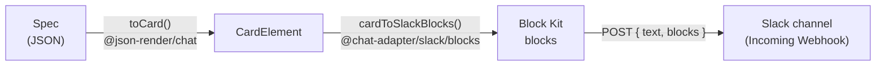

# json-render-slack

An agent skill for Claude Code and other agents that read `SKILL.md`. It turns a [json-render](https://json-render.dev) spec into a **native Slack message**, with real charts, tables, fields and link buttons, and posts it through a plain **Incoming Webhook**. You don't need a Slack bot, a bot token or a Chat SDK instance.



## Why

[`@json-render/chat`](https://www.npmjs.com/package/@json-render/chat) renders generative UI into Slack, Teams and other chat apps through the Vercel Chat SDK. The documented setup assumes a Slack bot (`SLACK_BOT_TOKEN`, signing secret, `thread.post`). Most "post a report to a channel" jobs only have a webhook URL. The two pure functions in the middle of that pipeline work without a bot. The skill explains how to use them and what Slack does with each component.

The most useful part covers things the docs don't say, all found by running the code and pinned by tests in this repo:

- **Elements that break a Slack rule degrade without an error.** This applies to a 3rd chart, a 2nd table, a chart label over 20 characters, and duplicate categories. The adapter turns the element into a monospace code block and the message still posts.
- **Some limits cut content with no warning.** More than 10 fields in one group, or more than 50 blocks in a message, are dropped.
- **mrkdwn is not escaped.** In `Text`, `Field` values and `Card.subtitle`, `<`, `>` and `&` from your data turn into links or mentions, or disappear.
- **`Table.align` is accepted but ignored** by Slack's native table.
- **Interactive `Button`s need Interactivity** on the webhook's Slack app. `LinkButton` works anywhere.

## What the agent gets

| Path | What it is |
|---|---|
| [`skills/json-render-slack/SKILL.md`](skills/json-render-slack/SKILL.md) | The workflow: install, the conversion code, how to build a spec, Slack's limits, escaping, buttons, checks before posting |
| [`references/mapping.md`](skills/json-render-slack/references/mapping.md) | Every component, its props and the exact Block Kit it becomes, plus all limits |
| [`references/example-report.ts`](skills/json-render-slack/references/example-report.ts) | A complete weekly analytics report builder: totals as fields, a this-week vs last-week line chart, a top-N table and a top-N bar chart |
| [`scripts/spec-to-blocks.ts`](skills/json-render-slack/scripts/spec-to-blocks.ts) | Converts a spec file, prints the Block Kit and warns about degraded charts or tables. `--post` sends it to `$SLACK_WEBHOOK_URL` |
| [`evals/`](skills/json-render-slack/evals) | Test cases for the skill, in the format `claude plugin eval` reads |

## Install

**Claude Code plugin**

```
/plugin marketplace add SergeyGalaxyOrsik/json-render-slack
/plugin install json-render-slack@json-render-slack
```

**As a plain skill**, for Claude Code or any agent that loads `SKILL.md` folders:

```bash
git clone https://github.com/SergeyGalaxyOrsik/json-render-slack
cp -R json-render-slack/skills/json-render-slack ~/.claude/skills/
```

Then ask for something like *"post our weekly metrics to Slack as a card with a chart, we only have a webhook"* and the skill loads by itself.

## Using the code without an agent

The core is about ten lines. In your project:

```bash
bun add @json-render/core @json-render/chat @chat-adapter/slack chat zod
```

```ts
import { toCard } from "@json-render/chat";
import { cardToSlackBlocks, cardToSlackFallbackText, type SlackCardElement } from "@chat-adapter/slack/blocks";

const card = toCard(spec) as SlackCardElement; // spec.root must be a Card
await fetch(process.env.SLACK_WEBHOOK_URL!, {
  method: "POST",
  headers: { "content-type": "application/json" },
  body: JSON.stringify({ text: cardToSlackFallbackText(card), blocks: cardToSlackBlocks(card) }),
});
```

Check a spec before sending it:

```bash
bun skills/json-render-slack/scripts/spec-to-blocks.ts spec.json
SLACK_WEBHOOK_URL=https://hooks.slack.com/services/... bun skills/json-render-slack/scripts/spec-to-blocks.ts spec.json --post
```

## Versions

Verified with `@json-render/chat@0.22.0`, `@chat-adapter/slack@4.45.0` and `chat@4.45.0`. [`test/mapping.test.ts`](test/mapping.test.ts) pins every behavior the skill documents. To check a newer release, bump the versions in `package.json` and run:

```bash
bun install
bun test
```

If a test fails, the skill's mapping needs updating. Pull requests are welcome.

## Development

```bash
bun install
bun test              # mapping and example report tests
bun run check-types
claude plugin eval skills/json-render-slack --allow-tools Write,Edit,Bash --scaffold   # skill evals, billed model runs
```

## License

[MIT](LICENSE). Not affiliated with Vercel, Slack or the json-render project.
